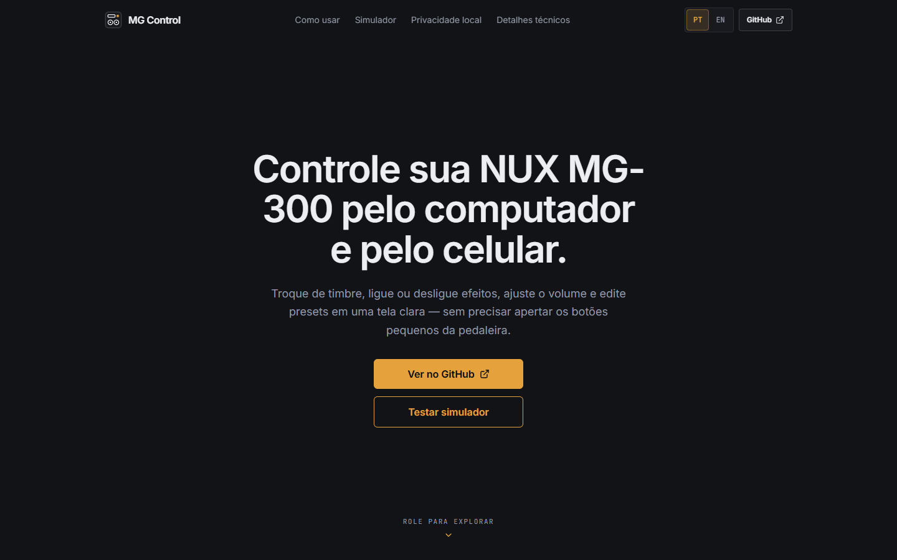
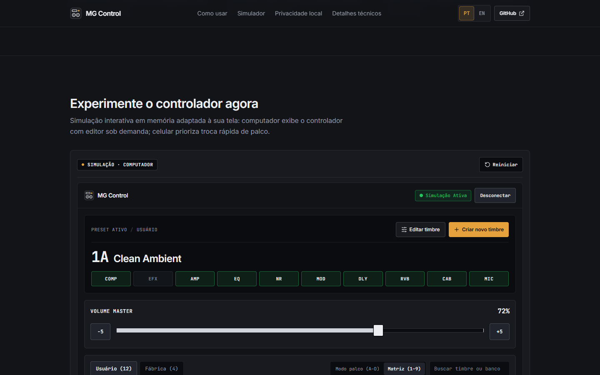
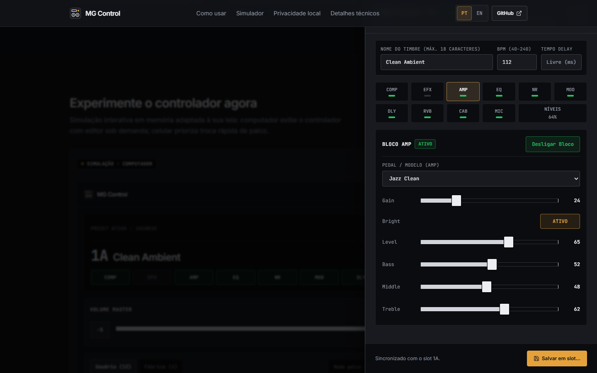
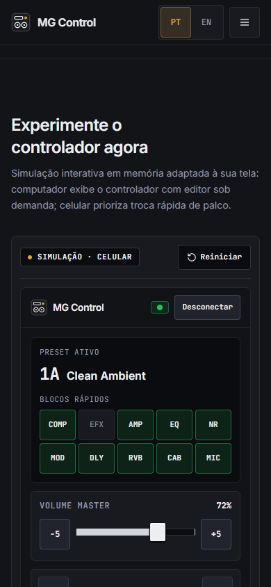
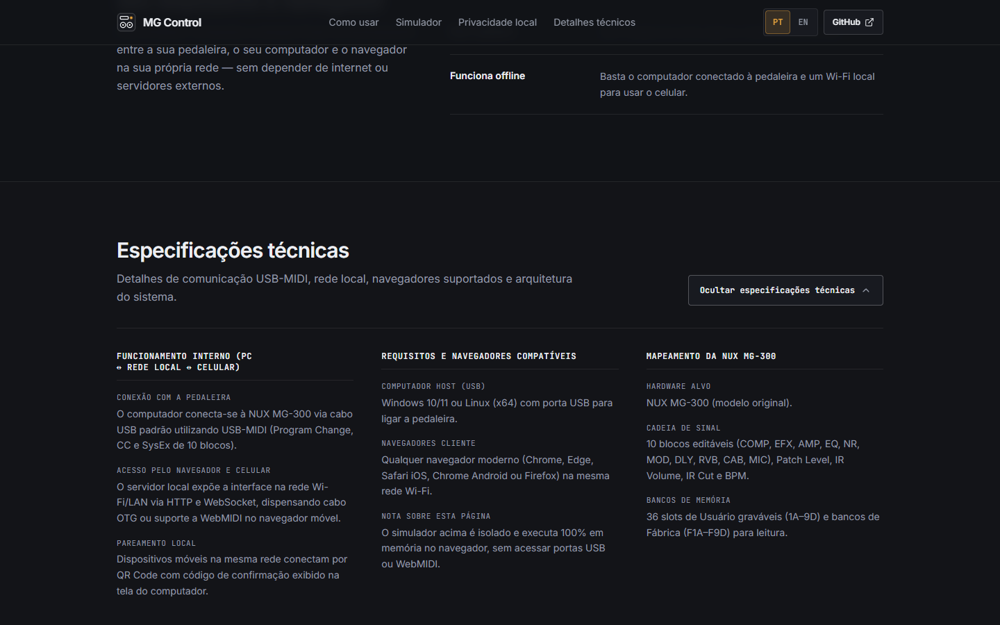
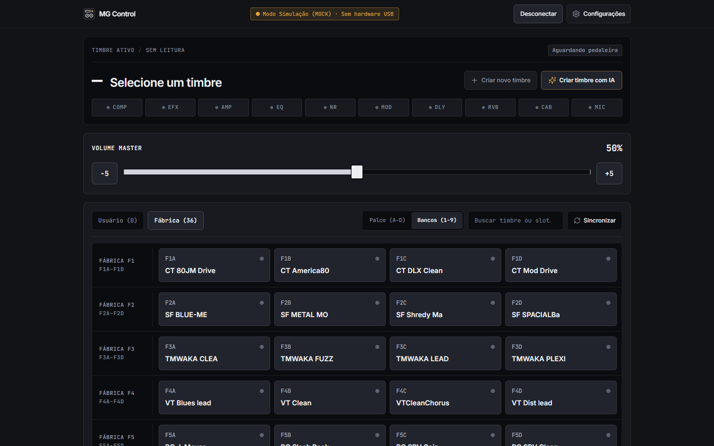
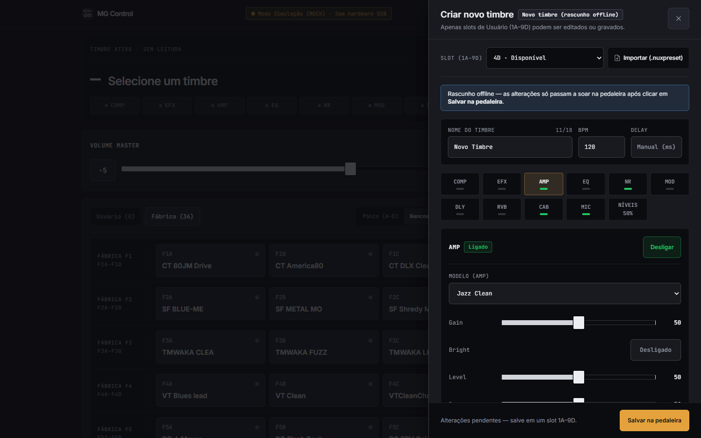
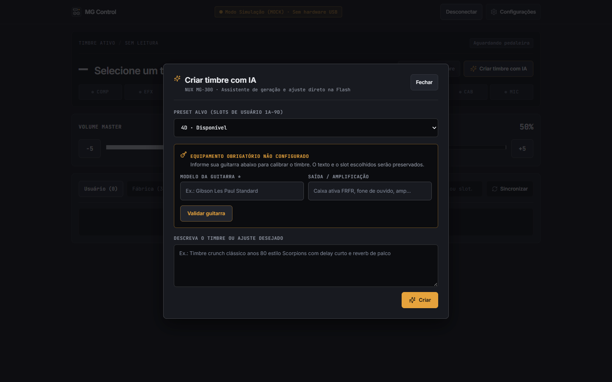
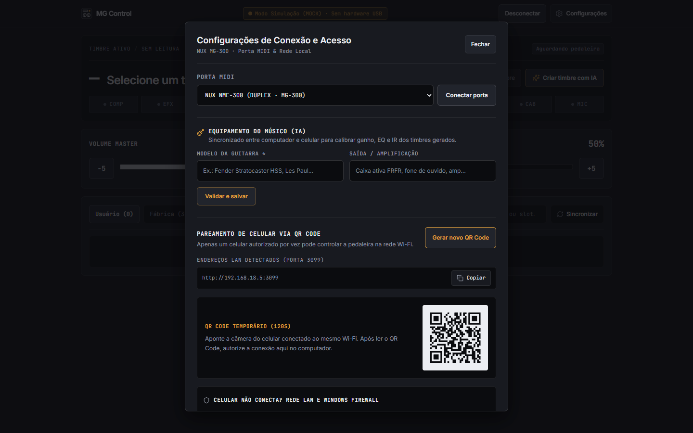
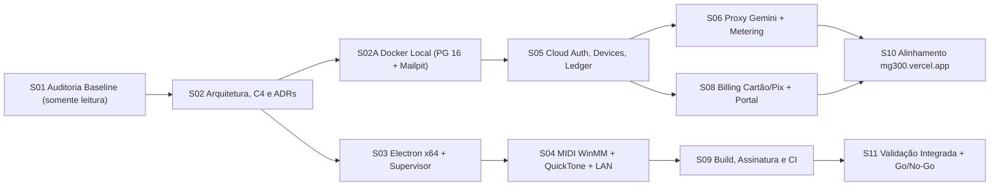

# MG Control — Do Projeto Local à Produção: Arquitetura, Prints Reais, Agentes, Skills e os Desafios de Lançar um Software

> **Repositório principal:** [P3dro236/MG300-WEBAPP](https://github.com/P3dro236/MG300-WEBAPP)  
> **Landing page publicada:** [https://mg300.vercel.app](https://mg300.vercel.app)  
> **Aviso de marca:** O **MG Control** é um projeto independente desenvolvido para guitarristas que utilizam a pedaleira **NUX MG-300**. Não possui vínculo, parceria ou endosso oficial da NUX / Cherub Technology.

---

## 1. Visão Geral e Escopo do Projeto

O **MG Control** nasceu para resolver um problema prático de quem toca guitarra com a **NUX MG-300**: editar timbres, alternar bancos e ajustar volumes rapidamente sem precisar se abaixar até a pedaleira nem depender exclusivamente do aplicativo legado no computador.

Ao longo da evolução do projeto, o escopo deixou de ser apenas um controlador web local e passou a estruturar um produto completo, organizado em um monorepo TypeScript (`npm workspaces`):

| Camada / Workspace | Pacote | Responsabilidade real | Status atual |
|---|---|---|---|
| **Contratos e Catálogo** | `@quicktone/shared` | Catálogo da MG-300, protocolo MIDI/SysEx (`CC 60`, `CC 64`, `0x0E`), schemas Zod e contratos `v1` | Implementado (`S01`–`S04`) |
| **Leitor QuickTone** | `@quicktone/quicktone-reader` | Parser *read-only* de arquivos `.nuxpreset` (`V1`, `V2`, `V4`, bundle `MG300AllPreset` de 36 slots) e JSON | Implementado (`S01`–`S04`) |
| **Transporte USB-MIDI** | `@quicktone/midi` | `MidiService`, `WinMmMidiAdapter` (`winmm.dll` duplex) e `MockMidiAdapter` isolado | Implementado; smoke físico pendente (`S04`) |
| **Núcleo Local** | `@quicktone/backend` | Servidor Fastify + WebSocket (`/ws`), pareamento LAN por QR Code, editor 10 blocos, calibração e módulo IA | Implementado (`S01`–`S04`) |
| **Interface Web / UI** | `@quicktone/frontend` | React 19 + Tailwind CSS v4 + `@fontsource` locais (funciona 100% sem internet) | Implementado (`S01`–`S04`) |
| **Desktop Standalone** | `@quicktone/desktop` | Shell Electron Windows x64 (`LocalCoreSupervisor`, preload allowlist, CSP, DPAPI e instalador NSIS) | Implementado (`S03`–`S04`) |
| **Ambiente Cloud Local** | `compose.yaml` + `infra/` + `scripts/` | PostgreSQL 16 + Mailpit em Docker local para desenvolver/testar Cloud antes de contratar servidor | Em implantação (`S02A` / Fase 3) |
| **Cloud Backend, Billing & Portal** | Fases `S05`–`S08` | API `/v1`, Auth 6 dígitos, proxy Gemini server-side, ledger de créditos, Stripe/Mercado Pago, Portal e Admin | Planejado (`S05`–`S08`) |
| **Landing Page** | [mg300.vercel.app](https://mg300.vercel.app) | Apresentação pública PT/EN e simulador interativo no navegador (repositório separado `MG300-WEBAPP-LANDING-PAGE`) | Publicada; alinhamento v1.1 planejado (`S10`) |

### Regra inviolável do produto
Toda a operação local — **USB-MIDI, leitura de `.nuxpreset`, editor de 10 blocos e controle pelo celular via Wi-Fi/LAN** — funciona **100% offline, sem conta e sem licença**. A camada Cloud (em implantação) existe exclusivamente para recursos online opcionais: geração de timbres via IA no servidor, gestão de créditos, até 3 dispositivos protegidos por DPAPI e portal de conta/compras.

---

## 2. Demonstração Visual Real (Capturas via Chrome + Servidor MCP)

Todas as imagens abaixo são **capturas reais** obtidas nesta sessão por meio do servidor MCP `rea` (`capture_browser_scenario`) controlando uma instância real do **Google Chrome** sobre:
1. A landing page em produção: **[https://mg300.vercel.app/pt/](https://mg300.vercel.app/pt/)**.
2. A aplicação real do repositório executada localmente (`packages/backend/dist/local-core.cjs` servindo `packages/frontend/dist`) em modo `MOCK` seguro.

### 2.1 Landing Page e Simulador Interativo (`mg300.vercel.app`)

#### Tela inicial (Hero PT — `1440×900`)

#### Simulador interativo em memória no navegador
O visitante consegue testar a lógica de troca de bancos, cadeia de sinal de 10 blocos (`COMP` a `MIC`) e controle de `Volume Master` diretamente no navegador, sem instalar nada:

#### Editor de timbres dentro do simulador da landing

#### Experiência responsiva Mobile (`390×844`)
No celular, o layout prioriza troca rápida de palco e blocos essenciais sem transbordamento horizontal:

#### Privacidade local e especificações técnicas (e o contraste com a evolução v1.1)

> **Achado real de auditoria (`DEC-03` / `R-11`):** Como se vê no print acima, a landing atual em `mg300.vercel.app` ainda comunica *"Zero nuvem / Sem cadastro"*, pois nasceu antes da definição do pacote operacional v1.1. Esse desalinhamento já está registrado na matriz de riscos para ser corrigido na Etapa `S10`, deixando claro que **o controlador local/LAN continua 100% offline**, enquanto a **IA por créditos** passa a operar via Cloud API.

---

### 2.2 Aplicação Real `MG Control` (Local Core + Frontend Compilado)

#### Dashboard principal com proteção explícita de modo `MOCK` e 36 presets de fábrica
Na Etapa `S04`, o badge superior passou a exibir explicitamente `Modo Simulação (MOCK) · Sem hardware USB` quando executando sem pedaleira física — evitando falsos positivos de conexão:

#### Editor completo de 10 blocos + importação de `.nuxpreset`
Rascunho offline dos 10 blocos (`COMP`, `EFX`, `AMP`, `EQ`, `NR`, `MOD`, `DLY`, `RVB`, `CAB`, `MIC`) e níveis, com gravação segura em slots de Usuário (`1A–9D`) e bloqueio de slots de Fábrica (`F1A–F9D`):

#### Assistente de timbre com IA (`Criar timbre com IA`)
Modal que exige o cadastro prévio da guitarra e saída/amplificação para calibrar ganho, EQ e IR dentro do pipeline determinístico da MG-300:

#### Configurações de Porta MIDI, URLs LAN priorizadas e QR Code temporário (120s)
Geração real de QR Code de uso único para parear um celular na mesma rede Wi-Fi privada, priorizando adaptadores físicos sobre interfaces virtuais (WSL/Docker/VPN) e trazendo guia integrado para Windows Defender Firewall:

---

## 3. Como Agentes, Skills, Regras e MCP Estão Sendo Usados

Em vez de usar IA de forma improvisada ("pede código e torce para funcionar"), o repositório adota uma **engenharia orientada a etapas, contratos, papéis independentes e gates objetivos**.

### 3.1 Fluxo Sequencial por Etapas e Gates (`S01` → `S11`)
Conforme registrado em [INDEX-OPERACIONAL.md](INDEX-OPERACIONAL.md) e no pacote normativo em `docs/prod_decision/`:

Cada etapa só avança mediante evidência objetiva: `npm run typecheck`, `npm run test` (Vitest), `npm run test:e2e` (Playwright Web + Electron), `smoke:packaged` no executável Windows e parecer favorável do revisor independente. Pendências físicas (como testar com a pedaleira NUX MG-300 ligada via USB ou com um celular real em Wi-Fi isolado) são marcadas explicitamente como `PENDING (BLOCKED_BY_PHYSICAL_HARDWARE)` em vez de serem mascaradas por mocks.

### 3.2 Separação de Papéis Multiagente e Skills Utilizadas

| Recurso / Skill | Papel no fluxo do projeto | Como foi aplicado na prática |
|---|---|---|
| **`code-review` (Revisor independente somente leitura)** | Impede que o mesmo agente que escreveu o código aprove a própria entrega. | Nas entregas `S03` e `S04` ([S03](changes/S03-ELECTRON-SHELL-E-ORQUESTRACAO.md), [S04](changes/S04-MIDI-QUICKTONE-E-LAN.md)), a 1ª rodada apontou problemas `ALTO` e `MÉDIO` reais (ex.: race de restart no supervisor, fallback de porta, ausência de listener de erro em `stdin` do worker WinMM); somente após correção e reteste a 2ª rodada emitiu **`APROVADO`**. |
| **`refactoring-modernization` (Arquiteto / Dev / Auditor)** | Fluxo sob demanda para mudanças estruturais com preservação funcional obrigatória. | Separação clara entre diagnóstico/ADRs, implementação incremental com testes de caracterização e auditoria final sem remoção silenciosa de funcionalidades. |
| **`unslop` (Craft de Frontend)** | Elimina estética genérica de IA em toda alteração de UI. | Aplicado na interface do controlador e na landing: paleta anódica de alto contraste, tipografia técnica com `tabular-nums` para slots e volumes, alvos táteis `>= 44px` para uso no palco/celular e zero gradientes ou animações decorativas. |
| **`prompt-engineering`** | Transforma pedidos soltos em especificações executáveis e verificáveis. | Usado para estruturar prompts com escopo fechado, restrições de evidência real, critérios de aceite e proteção contra alterações fora do escopo. |
| **Servidor MCP `rea` + Chrome (CDP / Playwright)** | Inspeção real de navegador, DOM, acessibilidade e captura de screenshots sem simulação manual. | Nesta documentação, o `rea` (`capture_browser_scenario`) abriu o Chrome real contra `mg300.vercel.app` e contra o `local-core.cjs` empacotado, coletando árvore de acessibilidade, DOM e os 9 prints reais acima. |
| **Regras Globais (`GEMINI.md`)** | Guardrails permanentes de engenharia. | Exige Conventional Commits, proíbe segredos/tokens no repositório, exige verificação real pós-edição e bloqueia `push` ou mudanças destrutivas sem validação/autorização explícita. |

---

## 4. A Realidade de Lançar um Software: Infraestrutura, AWS, Escalabilidade e Acessos

Colocar um software no ar vai muito além de *"fazer o código funcionar no meu computador"*. Ao longo da construção do **MG Control**, ficou evidente o quanto o processo de lançamento envolve decisões críticas de infraestrutura, custo, escala e segurança — e como cada escolha mal dimensionada cobra seu preço depois.

Os pontos abaixo conectam diretamente esses desafios práticos ao que já está documentado e planejado no projeto:

### 4.1 Escolha de Provedor e Infraestrutura (AWS / Cloud Gerenciada vs. VPS)
Quando se sai do `localhost`, surgem dezenas de peças invisíveis: banco de dados, backups, TLS, e-mail transacional, distribuição de binários e proxy de API.
- **O dilema real:** Serviços gerenciados de nuvem (como **AWS EC2/RDS/S3/SES**) entregam alta disponibilidade e automação, mas exigem domínio de IAM, VPC, grupos de segurança, NAT/egress e podem gerar faturas imprevisíveis se um ataque ou loop de download estourar banda/requisições. Por outro lado, uma **VPS Linux** concentra custo previsível, mas transfere a responsabilidade de patching, firewall, backup e monitoramento para quem mantém o projeto.
- **Como o projeto está tratando isso (sem precipitação):** Em [02-DECISOES-ESTRATEGICAS.md](prod_decision/MG-Control-Pacote-Operacional/mg-control-operacional/pedro/02-DECISOES-ESTRATEGICAS.md) e no [ADR-013](architecture/ADRS.md), foi fixado um teto inicial de **~R$150/mês**, exigindo comparação formal de **preço de renovação, egress, impostos, backups externos, região/latência no Brasil e plano de saída** (S3 / Cloudflare R2 / Vercel Blob para distribuir o instalador de ~88 MB + `.sha256`; Resend / Postmark / Brevo / AWS SES com SPF/DKIM/DMARC para e-mail transacional).
- **Decisão inteligente antes de gastar:** Antes de contratar qualquer VPS ou conta cloud paga, a Etapa `S02A` montou um ambiente local reproduzível em Docker (`compose.yaml` com PostgreSQL 16 + Mailpit) para validar **100% do backend, migrations, e-mails de 6 dígitos, pagamentos em sandbox e restore de banco** localmente sem gastar um real.

### 4.2 Escalabilidade sem Overengineering Prematuro
Escalar não é montar um cluster Kubernetes no dia zero; é saber **onde o sistema realmente sofre carga** e isolar esses gargalos.
- **Vantagem arquitetural do MG Control:** Como o controle USB-MIDI, a leitura de `.nuxpreset` e a sincronização celular↔PC acontecem **localmente na rede do músico**, 1.000 usuários usando a pedaleira offline geram **zero requisições** no servidor cloud (registrado em [03-REQUISITOS-MINIMOS-INFRA-E-SITE.md](prod_decision/MG-Control-Pacote-Operacional/mg-control-operacional/pedro/03-REQUISITOS-MINIMOS-INFRA-E-SITE.md)).
- **Onde a escala realmente importa:**
  1. **Proxy de IA (Gemini):** chamadas externas lentas e com custo financeiro por token. Exige controle de concorrência, limite de tokens (`usageMetadata` gravado por geração), rate limit por IP/conta/dispositivo, orçamento máximo diário/mensal e um `AI_KILL_SWITCH`.
  2. **Banco de dados e webhooks de pagamento:** transações ACID no PostgreSQL (monólito modular Fastify em vez de microsserviços prematuros), com evolução planejada por faixas (`0–100 MAU` → `100–1.000 MAU` → `1.000+ MAU`) e separação futura de banco/pooler apenas quando métricas reais justificarem.
  3. **Distribuição de instaladores:** retirar binários pesados da API e servir via Object Storage/CDN com checksum SHA-256.

### 4.3 Acessos, Identidade, Segurança e Billing (Onde Mora o Maior Risco)
Lançar um software comercial transforma cada brecha de acesso em prejuízo financeiro ou jurídico:
- **Segregação entre acesso local e acesso cloud:** Nenhum bloqueio de conta, suspensão ou queda de servidor pode impedir o guitarrista de usar sua pedaleira localmente (`ADR-015` / `ADR-021`).
- **Identidade de dispositivo e anti-abuso sem fricção falsa:** Para evitar criação infinita de contas atrás dos 3 créditos gratuitos, a arquitetura (`ADR-015` + `0001_initial_schema.sql`) prevê par de chaves **Ed25519 protegido por Windows DPAPI** (`Electron safeStorage`), limite atômico de **3 dispositivos ativos por conta** (`SELECT ... FOR UPDATE`) e tabela `trial_grants` com constraint única por dispositivo — enquanto o estado atual (`R-22`) ainda marca a migração da identidade de texto plano para Ed25519+DPAPI como pendente da Fase 6.
- **Gestão de sessões e verificação:** Access token curto em memória + refresh token rotativo com hash SHA-256 e detecção de reuso; verificação por código numérico de 6 dígitos (TTL 10 min) sem enumeração de e-mails.
- **Segurança financeira e RBAC administrativo:** O cliente nunca define saldo ou status de pagamento. Créditos só entram via `credit_ledger` imutável (`reserve → consume / release` idempotentes) ou via **webhook assinado** (Stripe/Mercado Pago, nunca por redirect do navegador). O Painel Admin (`/v1/admin/*`) exige RBAC estrito, bootstrap seguro via `ADMIN_BOOTSTRAP_TOKEN` (zero senhas padrão no código) e registro obrigatório em `admin_audit_logs`.
- **Segredos e código empacotado:** Hoje existe o risco P0 `R-01` (chaves Gemini em `.env` local no protótipo atual) e `R-02` (caminhos pessoais no `discovery.ts`), ambos mapeados e bloqueantes antes de qualquer distribuição pública (`S05`/`S09`).

---

## 5. Estado Atual vs. Próximos Marcos

- **Concluído e validado no código:** Monorepo estruturado (`S01`–`S04`), Electron Windows x64 empacotável (`MG Control Setup 1.0.0.exe` em build local de teste), `WinMmMidiAdapter` endurecido, pareamento LAN offline por QR Code, e suites automatizadas (`typecheck`, Vitest unit/integrado, Playwright Web + Electron e `smoke:packaged`).
- **Em execução / Pendente antes do lançamento público:**
  - Conclusão do gate Docker local (`S02A` — PostgreSQL 16 + Mailpit).
  - Implementação das Fases `S05`–`S08` (Cloud API `/v1`, proxy Gemini, Billing Sandbox Cartão/Pix, Portal Web e Painel Admin).
  - Correção dos bloqueadores de distribuição (`R-01` remoção de chaves do cliente, `R-02` remoção de caminhos pessoais, `R-04` helper WinMM pré-compilado, Code Signing Windows).
  - Alinhamento da landing `mg300.vercel.app` (`S10`) e smoke test físico presencial com **NUX MG-300 real + celular em Wi-Fi isolado + 2º PC Windows** (`S04`/`S11`).
