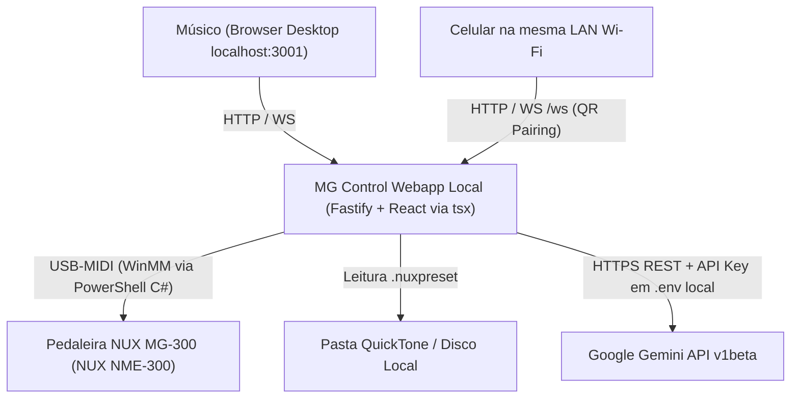
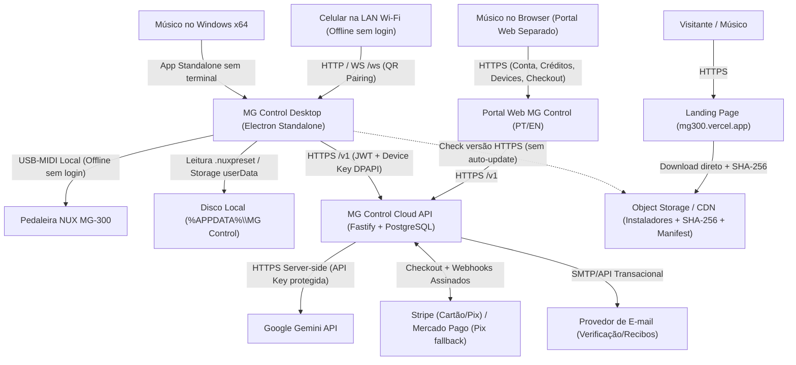
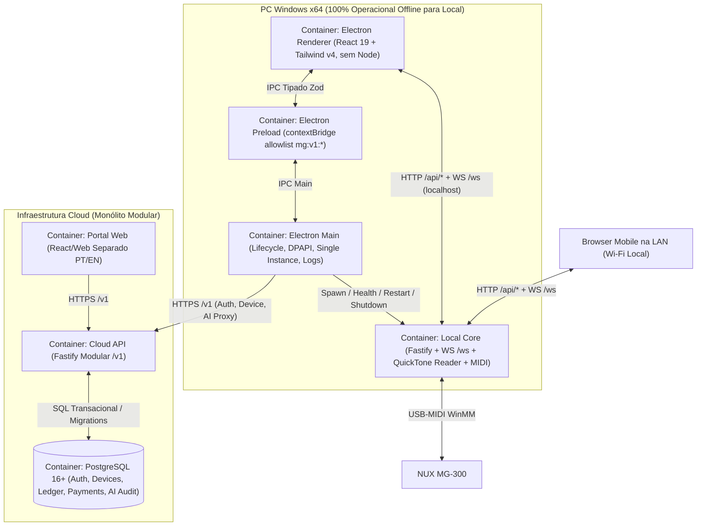
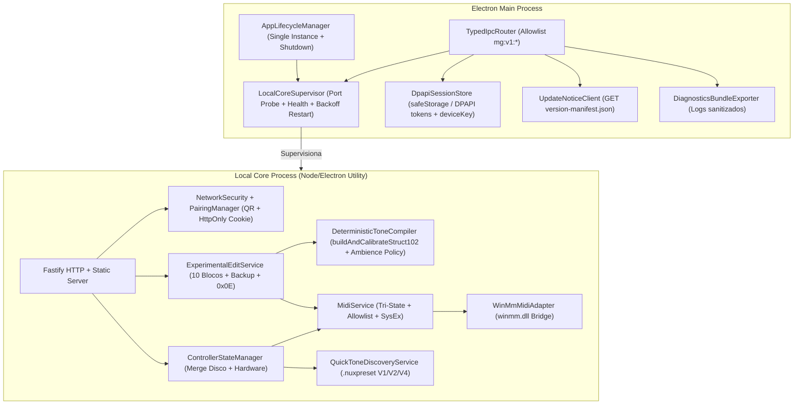
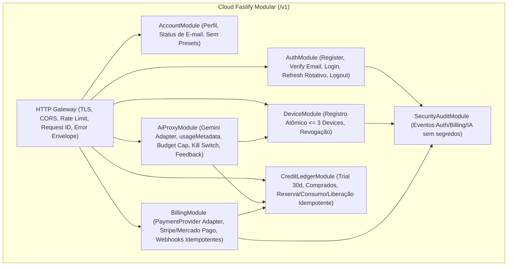

# Arquitetura C4, Ownership e Limites — MG Control

> **Etapa:** S02 — Arquitetura, Contratos e Migração
> **Data:** 2026-11-28
> **Versão:** 1.0 (`contracts-v1`)

---

## 1. C4 Nível 1 — Contexto (Atual vs. Alvo)

### 1.1 Contexto Atual (Baseline S01)

### 1.2 Contexto Alvo (`S03`–`S10`)

---

## 2. C4 Nível 2 — Containers

---

## 3. C4 Nível 3 — Componentes Internos

### 3.1 Electron Shell & Local Core

### 3.2 Cloud Backend Modular (`/v1`)

---

## 4. Ownership e Fronteiras Estritas por Módulo

| Módulo | Responsabilidades Exclusivas | Proibições Absolutas (Limites) |
|---|---|---|
| **Electron Main** | Single instance, lifecycle do app e do Local Core, resolução de `userData`, guarda segura de sessão/device key via DPAPI/`safeStorage`, verificação passiva de versão, exportação de diagnóstico sanitizado, navegação externa controlada (`https://`). | **Proibido:** duplicar rotas HTTP/WS do Local Core, acessar USB-MIDI diretamente fora do Core, armazenar segredos de Cloud/Gemini/Gateway, bloquear recursos locais sem login. |
| **Preload IPC** | Expor via `contextBridge` somente os canais da allowlist `mg:v1:*` com validação estrita de payload. | **Proibido:** expor `ipcRenderer` genérico, `fs`, `child_process`, `process.env` ou qualquer primitiva Node ao Renderer. |
| **Renderer (React UI)** | Interface Desktop/Mobile (Palco, Matriz, Editor 10 blocos, Pareamento LAN, Modal IA, UI de Conta/Saldo somente via IPC/API tipada), persistência local de preferências/cache no browser. | **Proibido:** `nodeIntegration`, importar módulos Node, guardar `GEMINI_API_KEY`, confiar em saldo local para liberar IA, chamar Gemini diretamente. |
| **Local Core (`@quicktone/backend` + `@quicktone/midi` + `@quicktone/reader`)** | Servidor HTTP/WS local, pareamento QR LAN e sessão única mobile, leitura `.nuxpreset`, comunicação USB-MIDI WinMM, edição 10 blocos, backup local pré-`0x0E`, compilação/calibração determinística `struct102` (consumindo plano vindo da Cloud na IA). | **Proibido:** exigir internet ou conta para MIDI/presets/LAN, conter `GEMINI_API_KEY` ou segredos de pagamento em produção, alterar firmware da MG-300, gravar em slots Factory (`36..71`). |
| **Cloud Backend (`/v1` + PostgreSQL)** | Auth, verificação de e-mail, sessões refresh hashed, registro e limite atômico de 3 dispositivos, ledger transacional de créditos, proxy Gemini server-side com medição de tokens/custo e kill switch, checkout e webhooks Stripe/Mercado Pago, feedback voluntário. | **Proibido:** acessar `localhost`/LAN do usuário, controlar MIDI, hospedar biblioteca/sync de presets no MVP, confiar em saldo/preço enviado pelo cliente, criar microservices separados sem necessidade medida. |
| **Portal Web Separado** | Fluxo autenticado web PT/EN: cadastro/login/verificação, visualização de saldo/ledger, compra de créditos (Cartão + Pix), gestão/revogação dos 3 dispositivos e dados da conta. | **Proibido:** comunicar com USB-MIDI, parear LAN local, armazenar presets ou conter chaves privadas de gateway/IA. |
