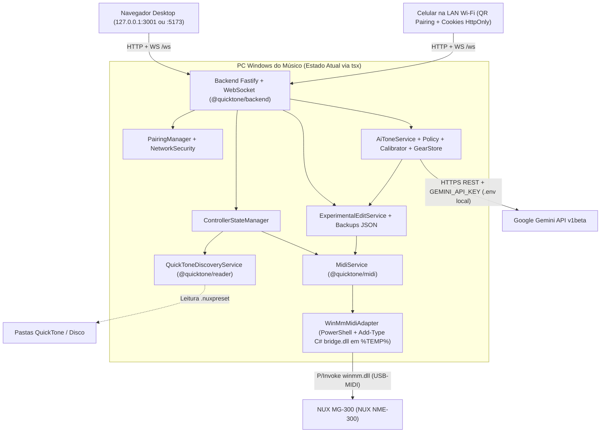
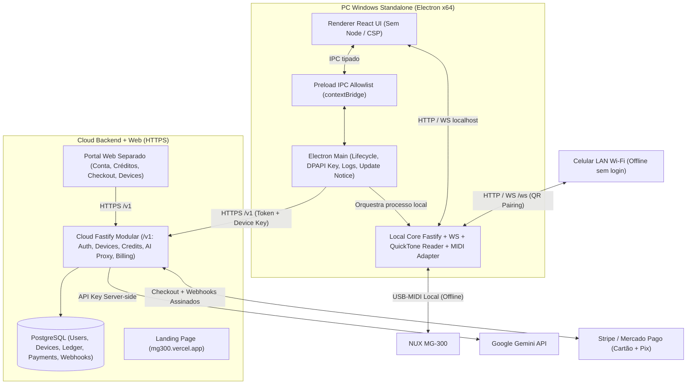
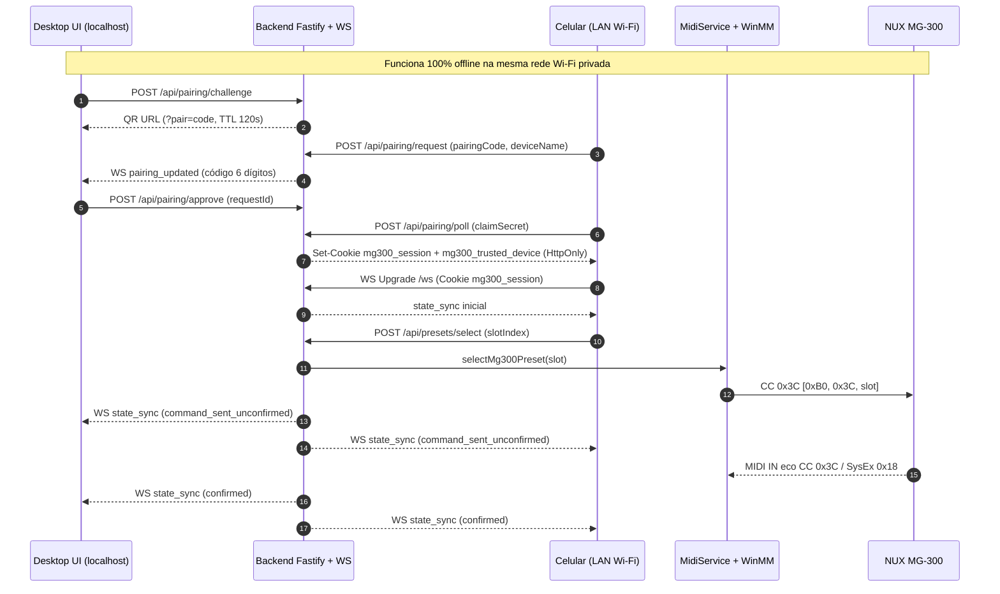

# Auditoria Baseline — MG Control (`NUXMG300-WEBAPP`)

> **Etapa:** S01 — Auditoria Baseline (somente leitura/diagnóstico; nenhum código funcional alterado)
> **Data da auditoria:** 2026-11-28
> **Regra de precedência:** O código real do repositório prevalece sobre a documentação prévia.

---

## 1. Identificação do Repositório, Ambiente e Comandos Reproduzíveis

| Item | Valor observado |
|---|---|
| Caminho local | `C:\Users\pedro\Desktop\mg\NUXMG300-WEBAPP` |
| Remote `origin` | `https://github.com/P3dro236/MG300-WEBAPP.git` |
| Branch atual | `feat/ai-tone-assistant` |
| Commit `HEAD` | `56120efb39ae489daaa42ea8616ea796c2d4d5a3` (`feat(ai): calibrar DLY/RVB e adotar prompt tecnico MG-300 com retorno estritamente numerico`) |
| Sistema operacional | `Microsoft Windows NT 10.0.26200.0` (`X64`) |
| Node.js / npm | `v24.22.3` / `11.19.1` |
| Tipo de projeto | Monorepo npm workspaces (`"type": "module"`, ESM) |
| `.env` na raiz | Presente e ignorado pelo `.gitignore`; chaves definidas: `GEMINI_API_KEY` (`set`), `GEMINI_API_KEY_2` (`set`) |

### Estado da Working Tree antes da S01 (`git status --porcelain`)
A branch `feat/ai-tone-assistant` possui alterações **não commitadas** anteriores à S01:
- **Modificados (6):**
  - `docs/TECHNICAL_DECISIONS.md`
  - `packages/backend/src/__tests__/ai-tone.test.ts`
  - `packages/backend/src/ai/ai-tone-service.ts`
  - `packages/backend/src/ai/tone-calibrator.ts`
  - `packages/backend/src/app.ts`
  - `packages/shared/src/contracts.ts`
- **Não rastreados (7 entradas):**
  - `docs/AI_DELAY_AMBIENCE_POLICY.md`
  - `docs/delay-decision.md`
  - `docs/prod_decision/`
  - `packages/backend/src/__tests__/delay-ambience-policy.test.ts`
  - `packages/backend/src/ai/ambience-policy.ts`
  - `packages/backend/src/ai/ambience-validator.ts`
  - `packages/backend/src/ai/tone-observability.ts`

### Comandos Reproduzíveis
```powershell
# Verificação de tipos em todos os 5 workspaces
npm run typecheck

# Build de produção atual (compila APENAS o frontend para packages/frontend/dist/)
npm run build

# Testes unitários e de integração (Vitest)
npm run test

# Testes E2E (Playwright com backend real + MockMidiAdapter + Chrome/Pixel 7)
npm run test:e2e

# Execução em produção local (executa TypeScript direto via tsx, servindo frontend dist/)
npm start

# Execução em modo desenvolvimento (2 terminais)
npm run dev:backend
npm run dev:frontend
```

---

## 2. Workspaces, Pacotes, Entrypoints e Scripts Reais

Pacote raiz: `quicktone-web-controller@1.0.0` (`private: true`, `"type": "module"`, [package.json](file:///C:/Users/pedro/Desktop/mg/NUXMG300-WEBAPP/package.json)).

| Workspace | Nome (`package.json`) | Entrypoint / Saída | Scripts reais | Observações |
|---|---|---|---|---|
| `packages/shared` | `@quicktone/shared` | `src/index.ts` (sem `dist/`) | `typecheck` | Catálogo MG-300, protocolo MIDI/SysEx e schemas Zod |
| `packages/quicktone-reader` | `@quicktone/reader` | `src/index.ts` (sem `dist/`) | `typecheck` | Parser read-only `.nuxpreset` (V1/V2/V4/bundle) + JSON + watcher |
| `packages/midi-service` | `@quicktone/midi` | `src/index.ts` (sem `dist/`) | `typecheck` | `MidiService`, `WinMmMidiAdapter`, `MockMidiAdapter`, `MidiDiagnosticsLogger` |
| `packages/backend` | `@quicktone/backend` | `src/index.ts` (sem `dist/`) | `dev` (`tsx watch`), `start` (`tsx`), `typecheck` | Fastify + `ws` + pareamento LAN + editor 10-blocos + módulo IA Gemini |
| `packages/frontend` | `@quicktone/frontend` | `src/main.tsx` → `dist/` | `dev`, `build` (`tsc --noEmit && vite build`), `preview`, `typecheck` | React 19 + Tailwind CSS v4 + fontes locais `@fontsource` |

**Descoberta crítica de build e ferramental:**
- `npm run build` executa `npm run build --workspaces --if-present`, o que compila **exclusivamente** `@quicktone/frontend` (`packages/frontend/dist/` com `sourcemap: true` em [vite.config.ts](file:///C:/Users/pedro/Desktop/mg/NUXMG300-WEBAPP/packages/frontend/vite.config.ts#L25-L28)). Os 4 pacotes Node não possuem script `build` e rodam via `tsx` em runtime.
- Não existem arquivos de CI (`.github/` ausente), linter (ESLint/Biome), formatador (Prettier), plugin de coverage nem estrutura Electron no repositório.

---

## 3. Rastreamento Ponta a Ponta (`UI → Backend Local → Gemini → Preset → MIDI → MG-300`)

### 3.1 Fluxo de Controle ao Vivo (Presets, Volume e Editor)
1. **UI (`packages/frontend`):** [App.tsx](file:///C:/Users/pedro/Desktop/mg/NUXMG300-WEBAPP/packages/frontend/src/App.tsx), [usePairingSession.ts](file:///C:/Users/pedro/Desktop/mg/NUXMG300-WEBAPP/packages/frontend/src/hooks/usePairingSession.ts), [useControllerSession.ts](file:///C:/Users/pedro/Desktop/mg/NUXMG300-WEBAPP/packages/frontend/src/hooks/useControllerSession.ts), [useToneEditorSession.ts](file:///C:/Users/pedro/Desktop/mg/NUXMG300-WEBAPP/packages/frontend/src/hooks/useToneEditorSession.ts) e [client.ts](file:///C:/Users/pedro/Desktop/mg/NUXMG300-WEBAPP/packages/frontend/src/api/client.ts) (`QuickToneApiClient` + `QuickToneWsManager`).
2. **Backend Local (`packages/backend`):** [app.ts](file:///C:/Users/pedro/Desktop/mg/NUXMG300-WEBAPP/packages/backend/src/app.ts) recebe REST/WS → delega para `ControllerStateManager` ([state-manager.ts](file:///C:/Users/pedro/Desktop/mg/NUXMG300-WEBAPP/packages/backend/src/state-manager.ts)) ou `ExperimentalEditService` ([experimental-edit.ts](file:///C:/Users/pedro/Desktop/mg/NUXMG300-WEBAPP/packages/backend/src/experimental-edit.ts)).
3. **MIDI Service (`packages/midi-service`):** `MidiService` ([midi-service.ts](file:///C:/Users/pedro/Desktop/mg/NUXMG300-WEBAPP/packages/midi-service/src/midi-service.ts)) valida mensagens via allowlists de `@quicktone/shared`:
   - Troca de preset: `CC 60` (`0x3C`) slots `0..71` (`1A..9D` Usuário `0..35`, `F1A..F9D` Fábrica `36..71`).
   - Volume exclusivo: `CC 64` (`0x40`) Master Volume `0..100` (ADR-002).
   - Edição RAM em tempo real: CCs experimentais `1..59, 71, 74` (`CC 70` bloqueado).
   - Tri-state rigoroso: comando enviado marca `command_sent_unconfirmed`; apenas MIDI IN do hardware (`CC 60`/`CC 64` ou SysEx `0x18`/`0x06`) muda `syncStatus` para `confirmed`.
4. **Transporte Windows (`WinMmMidiAdapter`):** [winmm-adapter.ts](file:///C:/Users/pedro/Desktop/mg/NUXMG300-WEBAPP/packages/midi-service/src/winmm-adapter.ts) **não usa addon Node-API C++**. Compila código C# embutido via `powershell.exe` + `Add-Type` para `%TEMP%\quicktone-winmm-<sha256-12>\bridge.dll`, invocando `winmm.dll` por P/Invoke (duplex MIDI IN/OUT, 8 buffers SysEx de 4096 B, auto-recovery em `mmresult=1`).
5. **Hardware (`NUX MG-300` / porta `NUX NME-300`):** Recebe CCs/SysEx via USB-MIDI; responde identity `NUX_MG1X` (`0x00 → 0x10`), status global (`0x19 → 0x18`), dump de slot (`0x07 → 0x06`) e ACK de escrita (`0x0E → 0x70 0x0E`).

### 3.2 Fluxo de Geração de Timbre por IA
1. **UI (`AiToneModal.tsx`):** Seleciona slot User `0..35`, garante `aiGear` cadastrado via `PUT /api/ai/gear`, bloqueia menção explícita a slots no prompt (`containsForbiddenSlotMention`), pede confirmação e envia `POST /api/ai/tone/apply`.
2. **Backend (`AiToneService.applyTone`):** [ai-tone-service.ts](file:///C:/Users/pedro/Desktop/mg/NUXMG300-WEBAPP/packages/backend/src/ai/ai-tone-service.ts#L532-L654) exige `aiGear` configurado e MIDI conectado, calcula baseline em `resolveCalibrationBaseline` (`hardware_user → nuxpreset_files → factory_default`) e executa `experimentalEdit.applyExternalTransform(slotIndex, ...)`:
   - Verifica identidade da pedaleira (`requireMg300` → `NUX_MG1X`).
   - Lê slot atual via SysEx (`0x07 → 0x06`) e decodifica `current` (`decodeCurrentPresetContext`).
   - Chama `GeminiClient.generateJson` com `TONE_SYSTEM_INSTRUCTION` e `TONE_RESPONSE_SCHEMA` numérico.
   - Valida payload com `RawAiToneResponseSchema` e normaliza com `toNormalizedPlan`.
   - Compila e calibra em `buildAndCalibrateStruct102` ([tone-calibrator.ts](file:///C:/Users/pedro/Desktop/mg/NUXMG300-WEBAPP/packages/backend/src/ai/tone-calibrator.ts)) + `resolveAmbiencePolicy` ([ambience-policy.ts](file:///C:/Users/pedro/Desktop/mg/NUXMG300-WEBAPP/packages/backend/src/ai/ambience-policy.ts)) + `validateAndEnforceAmbience` ([ambience-validator.ts](file:///C:/Users/pedro/Desktop/mg/NUXMG300-WEBAPP/packages/backend/src/ai/ambience-validator.ts)).
   - Grava backup JSON pré-sobrescrita, sanitiza para SysEx (`sanitizeStruct102ForSysEx`), envia `0x0E`, aguarda ACK `0x70 0x0E`, aguarda settle (200 ms), faz readback (`0x07`) e compara via `compareStruct102Readback`.
   - Registra observabilidade em `AiToneObservabilityRecorder` ([tone-observability.ts](file:///C:/Users/pedro/Desktop/mg/NUXMG300-WEBAPP/packages/backend/src/ai/tone-observability.ts)) e atualiza biblioteca + WebSocket (`experimental_state_sync` / `presets_updated` / `state_sync`).

---

## 4. Endpoints HTTP, WebSocket, Segurança de Rede e Protocolo LAN

### 4.1 Rede, Bind e Proteções ([index.ts](file:///C:/Users/pedro/Desktop/mg/NUXMG300-WEBAPP/packages/backend/src/index.ts), [app.ts](file:///C:/Users/pedro/Desktop/mg/NUXMG300-WEBAPP/packages/backend/src/app.ts), [network-security.ts](file:///C:/Users/pedro/Desktop/mg/NUXMG300-WEBAPP/packages/backend/src/network-security.ts))
- **Bind padrão:** `HOST=0.0.0.0`, `PORT=3001` (frontend Vite dev usa porta `5173` com proxy para `127.0.0.1:3001`).
- **DNS Rebinding & Rede Privada:** `onRequest` e WebSocket `upgrade` exigem `isAllowedLanHost` (loopback ou IP privado RFC1918/link-local) e `isPrivateOrLoopbackIp(remoteAddress)` (`127.0.0.0/8`, `10.0.0.0/8`, `192.168.0.0/16`, `172.16.0.0/12`, `169.254.0.0/16`, `::1`, `fe80::`, `fc00::/fd00::`).
- **CORS:** Dinâmico via `isAllowedLanOrigin` (`Access-Control-Allow-Origin: <origin>`, `Access-Control-Allow-Credentials: true`, métodos `GET, POST, PUT, OPTIONS`).
- **Firewall Windows:** Documentado em [MOBILE_ACCESS_GUIDE.md](file:///C:/Users/pedro/Desktop/mg/NUXMG300-WEBAPP/docs/MOBILE_ACCESS_GUIDE.md#L40-L43) — requer perfil de rede Privada e liberação da porta TCP `3001` no Windows Defender Firewall. Nenhuma regra automática é criada pelo app.
- **Desktop vs Mobile:** `resolveDesktopRequest` exige socket loopback + `Host` loopback + ausência de `X-Forwarded-*`/`Origin` não-loopback. Opcionalmente suporta `QUICKTONE_AUTH_TOKEN` para desktop.

### 4.2 Rotas HTTP REST (29 endpoints em `packages/backend/src/app.ts`)

| Grupo | Método e Caminho | Acesso / Auth | Função |
|---|---|---|---|
| Saúde | `GET /api/health` | Público na LAN | Status, uptime, `midiConnection`, `syncStatus` |
| Pairing Público | `GET /api/pairing/status` | Público na LAN | Estado desktop ou sessão/trust mobile |
| Pairing Público | `POST /api/pairing/request` | Público na LAN (rate-limit 5/60s) | Submete código QR, gera `requestId`, `claimSecret`, código 6 dígitos |
| Pairing Público | `POST /api/pairing/poll` | Público na LAN (`claimSecret`) | Entrega cookies `mg300_session` + `mg300_trusted_device` após aprovação |
| Pairing Público | `POST /api/pairing/trusted-login` | Público na LAN (cookie `mg300_trusted_device`) | Reautentica dispositivo confiável sem novo QR |
| Pairing Público | `POST /api/pairing/logout` | Público na LAN | Encerra sessão mobile e limpa cookie |
| Pairing Desktop | `POST /api/pairing/challenge` | Desktop-only (+ token se ativo) | Gera QR code uso único (TTL 120 s) |
| Pairing Desktop | `POST /api/pairing/approve` | Desktop-only (+ token se ativo) | Aprova celular (revoga sessão anterior) |
| Pairing Desktop | `POST /api/pairing/reject` | Desktop-only (+ token se ativo) | Rejeita solicitação pendente |
| Pairing Desktop | `POST /api/pairing/revoke` | Desktop-only (+ token se ativo) | Revoga sessão mobile ativa (WS close `4001`) |
| Pairing Desktop | `POST /api/pairing/trusted/remove` | Desktop-only (+ token se ativo) | Remove dispositivo confiável persistido |
| Core Controller | `GET /api/presets` | Desktop ou Mobile pareado | Lista presets mesclados (disco + hardware + fábrica) |
| Core Controller | `GET /api/status` | Desktop ou Mobile pareado | Snapshot `ControllerState` |
| Core Controller | `POST /api/presets/select` | Desktop ou Mobile pareado | Seleciona preset (`CC 0x3C`) + agenda readback |
| Core Controller | `PUT /api/volume` | Desktop ou Mobile pareado | Master Volume (`CC 0x40`, `0..100`) |
| Core Controller | `POST /api/volume/target` | Desktop ou Mobile pareado | Aceita apenas `master_cc64` |
| Core Controller | `POST /api/midi/connect` | Desktop ou Mobile pareado | Conecta porta MIDI |
| Core Controller | `POST /api/midi/disconnect` | Desktop ou Mobile pareado | Desconecta porta MIDI |
| Core Controller | `POST /api/presets/config` | Desktop ou Mobile pareado | Configura diretório QuickTone / flag fábrica |
| Core Controller | `POST /api/presets/reload` | Desktop ou Mobile pareado | Recarrega presets do disco / SysEx |
| Editor 10-Blocos | `GET /api/experimental/state` | Autenticado (se `experimentalEdit`) | Estado do rascunho/edição 10 blocos |
| Editor 10-Blocos | `POST /api/experimental/load` | Autenticado (se `experimentalEdit`) | Seleciona slot User `0..35` e lê via `0x07` |
| Editor 10-Blocos | `POST /api/experimental/new` | Autenticado (se `experimentalEdit`) | Cria rascunho em branco offline |
| Editor 10-Blocos | `POST /api/experimental/import` | Autenticado (se `experimentalEdit`) | Importa `.nuxpreset` base64 (até 512 KB) |
| Editor 10-Blocos | `PUT /api/experimental/meta` | Autenticado (se `experimentalEdit`) | Altera nome (`<=18`), BPM (`40..240`), `timeFlag` |
| Editor 10-Blocos | `PUT /api/experimental/param` | Autenticado (se `experimentalEdit`) | Altera parâmetro do AMP (`block=3`) |
| Editor 10-Blocos | `PUT /api/experimental/block` | Autenticado (se `experimentalEdit`) | Liga/desliga bloco `1..10` |
| Editor 10-Blocos | `PUT /api/experimental/block-model` | Autenticado (se `experimentalEdit`) | Troca modelo do bloco + resync de parâmetros |
| Editor 10-Blocos | `PUT /api/experimental/block-param` | Autenticado (se `experimentalEdit`) | Altera parâmetro `0..5` de qualquer bloco |
| Editor 10-Blocos | `PUT /api/experimental/level` | Autenticado (se `experimentalEdit`) | `patchVolume`, `irVolume`, `irCut`, `cab`, `mic` |
| Editor 10-Blocos | `POST /api/experimental/save` | Autenticado (se `experimentalEdit`) | Backup + escrita `0x0E` + ACK + readback |
| Editor 10-Blocos | `POST /api/experimental/discard` | Autenticado (se `experimentalEdit`) | Descarta rascunho |
| IA & Gear | `GET /api/ai/gear` | Desktop ou Mobile pareado | Lê `data/user-gear.json` |
| IA & Gear | `PUT /api/ai/gear` | Desktop ou Mobile pareado | Valida guitarra via Gemini e salva atomicamente |
| IA & Gear | `POST /api/ai/tone/apply` | Desktop ou Mobile pareado (requer `experimentalEdit`) | Gera/ajusta timbre via Gemini + grava Flash `0x0E` |

### 4.3 WebSocket (`/ws` e `/`) e Protocolo LAN Celular ↔ PC
- **Upgrade:** Valida `Host`, IP privado, `Origin`, e sessão mobile (`mg300_session` / `X-Session-Token` / `Bearer`).
- **Mensagens Server → Client:** `state_sync`, `presets_updated`, `pairing_updated` (enviada apenas para clientes `role === 'desktop'`), `experimental_state_sync`, `gear_updated`, `error`, `pong`.
- **Mensagens Client → Server:** `ping`, `request_sync`.
- **Sessão única mobile:** `PairingManager` ([pairing-manager.ts](file:///C:/Users/pedro/Desktop/mg/NUXMG300-WEBAPP/packages/backend/src/pairing-manager.ts)) garante no máximo **1 celular controlador ativo**; ao aprovar ou reconectar um novo celular, o anterior recebe fechamento WS `4001` (`4002` para expiração).
- **Operação sem internet:** Todos os assets React/CSS e fontes (`@fontsource/inter`, `@fontsource/jetbrains-mono`) são servidos localmente por Fastify (`packages/frontend/dist`). Apenas as rotas `/api/ai/*` dependem de internet externa.

---

## 5. Storage Local, Formatos de Preset, Backups e Caminhos Windows

### 5.1 Formatos Suportados (`packages/quicktone-reader/src/parser.ts`)
- Binário `.nuxpreset` (magic `"MG300 Preset Data"`, `productId=0x66`):
  - Single V1 (`payloadSize=0x209F` = 8.351 B ou compacto)
  - Single V2 (`payloadSize=0x20A0` = 8.352 B ou compacto)
  - Single V4 (`subver >= 10`, struct SysEx-safe de 103 B com nibbles de BPM em `+100/+101`)
  - Bundle `MG300AllPreset.nuxpreset` (36 slots, `0x49664` V1 / `0x49688` V2)
- Fallback JSON (`PresetSchema` ou formato simplificado) em leitura de pasta.
- Estrutura interna `struct102`: 102 bytes (`0x66`), nomes até 18 bytes (`0x45..0x56`, comprimento em `0x44`), 72 caracteres LCD da MG-300 (`0x00..0x47`).

### 5.2 Locais de Storage no Disco e Navegador (estado atual fragmentado)

| Dado | Caminho / Chave atual | Fonte no código | Observação crítica |
|---|---|---|---|
| Backups pré-gravação `0x0E` | `path.resolve(process.cwd(), 'backups')` (ex.: `packages/backend/backups/`, **41 JSONs** presentes) | [app.ts](file:///C:/Users/pedro/Desktop/mg/NUXMG300-WEBAPP/packages/backend/src/app.ts#L960-L962) | Depende de `process.cwd()`; sem política de retenção |
| Dispositivos confiáveis LAN | `path.resolve(process.cwd(), 'data', 'trusted-devices.json')` | [index.ts](file:///C:/Users/pedro/Desktop/mg/NUXMG300-WEBAPP/packages/backend/src/index.ts#L72) | Depende de `process.cwd()` (`packages/backend/data/`) |
| Equipamento IA (`user-gear.json`) | `path.resolve(MONOREPO_ROOT, 'data', 'user-gear.json')` | [index.ts](file:///C:/Users/pedro/Desktop/mg/NUXMG300-WEBAPP/packages/backend/src/index.ts#L69) | Ancorado no repo; falharia em `app.asar` |
| Log MIDI/IA (`midi-diagnostics.log`) | `<repo>/logs/midi-diagnostics.log` (rotação 5 MiB) | [diagnostics-logger.ts](file:///C:/Users/pedro/Desktop/mg/NUXMG300-WEBAPP/packages/midi-service/src/diagnostics-logger.ts#L15-L24) | Ancorado no repo; falharia em `Program Files` |
| Bridge C#/PS1 WinMM | `%TEMP%\quicktone-winmm-<sha256-12>\` | [winmm-adapter.ts](file:///C:/Users/pedro/Desktop/mg/NUXMG300-WEBAPP/packages/midi-service/src/winmm-adapter.ts#L610-L618) | Compilação runtime por `Add-Type` |
| Pastas QuickTone candidatas | `C:\Users\pedro\Documents\NUX`, `C:\Users\pedro\CrossDevice\S25+ de Pedro\storage\Download`, `C:\Users\pedro\Downloads`, `os.homedir()` | [discovery.ts](file:///C:/Users/pedro/Desktop/mg/NUXMG300-WEBAPP/packages/quicktone-reader/src/discovery.ts#L13-L21) | **Paths pessoais hardcoded do autor** |
| Browser `localStorage` | `mg300_webapp_storage_v1` (presets + prefs), `mg300_mobile_device_name` | [storage.ts](file:///C:/Users/pedro/Desktop/mg/NUXMG300-WEBAPP/packages/frontend/src/utils/storage.ts#L8), [MobilePairingGate.tsx](file:///C:/Users/pedro/Desktop/mg/NUXMG300-WEBAPP/packages/frontend/src/components/MobilePairingGate.tsx#L51) | Presets locais persistidos no navegador |

---

## 6. Auditoria da Integração Gemini

- **Cliente:** [gemini-client.ts](file:///C:/Users/pedro/Desktop/mg/NUXMG300-WEBAPP/packages/backend/src/ai/gemini-client.ts). **Não usa SDK** (`@google/genai`); usa `fetch` nativo contra `https://generativelanguage.googleapis.com/v1beta`.
- **Model IDs exatos configurados (`ALLOWED_GEMINI_MODELS`, linhas 85–90):**
  1. `models/gemini-3.8-flash` (thinking budget padrão `0`)
  2. `models/gemini-3.6-flash` (thinking budget padrão `0`)
  3. `models/gemini-4-hydrogen` (thinking budget padrão `undefined`)
  4. `models/gemini-3.5-flash-lite` (thinking budget padrão `0`)
- **Descoberta & Failover:** Consulta `GET /models` com header `x-goog-api-key` e cache em memória de 10 min (`GEMINI_MODEL_CACHE_TTL_MS=600000`). Faz failover entre `GEMINI_API_KEY` e `GEMINI_API_KEY_2` carregadas via `env.ts` (não lê `.env` automaticamente durante `VITEST=true` sem injeção).
- **Prompts e Parâmetros:**
  - Geração/edição (`POST /api/ai/tone/apply`): `TONE_SYSTEM_INSTRUCTION` ([ai-tone-service.ts](file:///C:/Users/pedro/Desktop/mg/NUXMG300-WEBAPP/packages/backend/src/ai/ai-tone-service.ts#L242-L265)), `TONE_RESPONSE_SCHEMA` numérico compacto (`intent: 0|1`, `name`, `mp`, `dp`, `bpm`, `tf`, `pv`, `iv`, `ic`, `b`), `temperature: 0.25`, `maxOutputTokens: 640`, `thinkingBudget: 0`, `timeoutMs: 12000`.
  - Validação de guitarra (`PUT /api/ai/gear`): `GEAR_VALIDATION_SYSTEM_INSTRUCTION` ([gear-store.ts](file:///C:/Users/pedro/Desktop/mg/NUXMG300-WEBAPP/packages/backend/src/ai/gear-store.ts#L19-L25)), `temperature: 0.2`, `maxOutputTokens: 512`, **sem `responseSchema`**.
- **Retries e Erros:** Até 3 tentativas por modelo em HTTP 400 (`thinkingConfig` não suportado → remove `thinkingConfig` e eleva `maxOutputTokens >= 2048`; `responseSchema` não suportado → remove `responseSchema`). Em 401/403 pula imediatamente para próxima chave; em 429/`RESOURCE_EXHAUSTED` propaga `AI_QUOTA_EXHAUSTED` (429) após tentar todas as chaves/modelos (pior caso: `2 chaves × 4 modelos × 3 tentativas = 24 requisições HTTP`).
- **Lacuna de custo/telemetria (crítica para S06):** `GoogleGenerateContentResponse` ignora `usageMetadata` (tokens de entrada, saída e thinking), modelo vencedor, número de tentativas e latência; nenhuma métrica de custo é registrada.

---

## 7. Comparativo Estado Atual vs. Plano Completo (`S02`–`S11`)

| Etapa | Já implementado no código real | Parcial / Divergente | Falta implementar |
|---|---|---|---|
| **S02 Arquitetura & Contratos** | ADRs `001`–`006` locais; contratos Zod em `packages/shared/src/contracts.ts`; fronteira local core + UI estabelecida | Nomenclatura legada `@quicktone/*`; storage em 6 locais; política de `edit_existing` (`intent=1`) e gear via IA sem definição de cobrança | Diagramas C4 alvo, ADRs de cloud/Electron/billing/update, contratos `/v1` e IPC versionados, plano de migração e compatibilidade |
| **S03 Electron Shell** | Backend Fastify já empacota e serve `packages/frontend/dist` em porta local (`3001`) | `packages/backend` roda via `tsx` sem bundle/compile; caminhos usam `process.cwd()`/`MONOREPO_ROOT` | Electron Main, Preload (`contextBridge` allowlist), `contextIsolation=true`, `nodeIntegration=false`, CSP, lifecycle/restart do core, paths em `app.getPath('userData')` |
| **S04 MIDI, QuickTone & LAN** | `WinMmMidiAdapter`, `MidiService` (tri-state, CC60, CC64, SysEx, `0x0E`, readback), `QuickToneDiscoveryService`, `PairingManager` + `ws` LAN offline completos e testados com mocks | `WinMmMidiAdapter` compila C# em `%TEMP%` via PowerShell em runtime; `discovery.ts` tem paths hardcoded do Pedro; **smoke físico MG-300/LAN na branch atual `PENDING`** | Remoção de paths pessoais, empacotamento MIDI compatível com Electron sem dependência frágil de `Add-Type`, diagnóstico exportável, validação limpa em 2º PC Windows |
| **S05 Cloud, Auth & PostgreSQL** | — | — | Todo o backend cloud (`/v1`), Fastify modular, PostgreSQL, migrations, Auth (verificação de e-mail, access+refresh rotativo hashed), registro DPAPI até 3 dispositivos, backup/restore |
| **S06 Proxy Gemini, Geração & Créditos** | `TONE_SYSTEM_INSTRUCTION`, schema estrito, compilador/calibrador determinístico, política DLY/RVB, validador de ambiência, redação de secrets | Gemini é chamado localmente pelo PC com `.env` local; allowlist contém 4 model IDs a confirmar; **sem `usageMetadata`/custo**; `PUT /api/ai/gear` gasta Gemini; `edit_existing` (`intent=1`) ativo | Proxy server-side na Cloud, ledger transacional/idempotente (3 trial 30d + comprados sem expiração), reserva/consumo/liberação, rate limits/budget cap/kill switch, feedback voluntário |
| **S07 Segurança & LGPD** | Anti-DNS rebinding, IP privado, CORS restrito, cookies `HttpOnly; SameSite=Strict`, HMAC/timing-safe SHA-256 em pairing, proteção de Factory slots `36..71`, redação básica de API keys | `sourcemap: true` em build prod; ausência de CSP; `0.0.0.0` aceito em `isAllowedLanHost`; tokens/chaves Gemini ainda no host local | Threat model completo, DPAPI device key, secret scan automatizado, security suite (XSS/CSP/IPC/CSRF/IDOR/replay), políticas LGPD e retenção |
| **S08 Billing, Portal & Webhooks** | — | — | Portal web separado (PT/EN), `PaymentProvider` adapter (Stripe cartão/Pix + fallback Mercado Pago Pix), checkout server-side, webhooks assinados/idempotentes, conciliação e e-mail transacional |
| **S09 Build, Distribuição & CI/CD** | `npm run build` gera `packages/frontend/dist` | Sem compile dos pacotes Node; sem `.github/workflows/` nem linters | Electron Builder/Forge, build reproduzível Windows x64, empacotamento MIDI na ABI correta, SHA-256, manifest de update + aviso/link, Code Signing (se aprovado), testes em Windows limpo |
| **S10 Landing `mg300.vercel.app`** | — | **Inspeção remota/repo indisponível na S01 (`PENDING`)** | Auditoria real do repo/site, alinhamento PT/EN com features S03–S09, requisitos Windows/USB, link oficial + hash, SEO/a11y/Lighthouse |
| **S11 Validação Integrada** | — | — | Suite integrada completa, hardware matrix em 2 PCs, restore testado, runbooks operacionais e Go/No-Go |

---

## 8. Diagramas de Arquitetura

### 8.1 Arquitetura Atual (Observada no Repositório)



### 8.2 Arquitetura Alvo (Local + Cloud — `S02` a `S10`)



### 8.3 Fluxo LAN em Tempo Real (`Celular ↔ PC Local Core ↔ MG-300`)



---

## 9. Pendências Explícitas (`PENDING`) da S01

1. **`PENDING` — Smoke Test Físico (`NUX MG-300` + Celular LAN sem internet):** Não executado na S01 porque não há pedaleira NUX MG-300 conectada nem celular em rede Wi-Fi isolada acoplado a esta sessão. Itens pendentes: conexão real `NUX NME-300`, leitura/escrita `0x0E`/readback, geração e aplicação de timbre IA em hardware, controle via celular LAN, desconexão/reconexão USB e operação sem internet.
2. **`PENDING` — Inspeção de `mg300.vercel.app` e seu repositório:** Não há repositório local do site nem permissão/acesso ao projeto Vercel nesta sessão; busca web pública retornou apenas referência genérica ao domínio. Aguarda identificação do repositório/projeto pelo Pedro.
